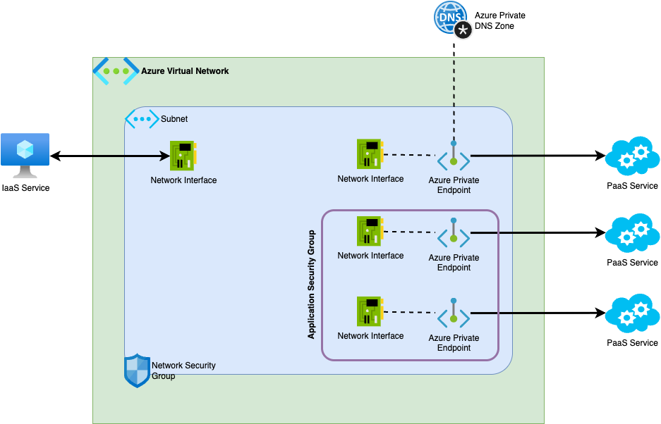

# 🌐 Azure Network Basis

### Comprendre son environnement réseau en Landing Zone

**Auteur :** Sylvain Riquen, Cloud Technical Architecte  
**Date :** avril 2026  
**Audience :** Équipe Développement

---

<style scoped>
  blockquote {
    margin: 40px 0;
    font-size: 26px;
  }
</style>

# 📦 Introduction

## Situations que vous avez déjà vécues

- *"Mon app ne répond plus depuis on-prem — et ça marchait hier !"*
- *"Mon conteneur ne peut pas télécharger depuis npmjs.com"*
- *"On m'a demandé de créer un subnet mais quelle plage IP je prends ?"*
- *"Mon API est derrière APIM, derrière un App Gateway — je ne sais plus qui fait quoi"*

> 💡 **Objectif :** Comprendre le réseau Azure pour ne plus subir ces situations — et avoir les bons réflexes au quotidien.

---

# 📚 Agenda

1. Les briques fondamentales : VNet, Subnet, NIC, NSG, ASG, DNS
2. Lire et découper son VNet en subnets
3. Hub & Spoke — l'architecture d'entreprise
4. Les flux entrants : Application Gateway, WAF, API Management
5. Synthèse & Take Away

---

<!-- _class: lead -->

<style scoped>
  h2 {
    font-size: 26px;
    margin-top: 30px;
  }
  img {
    width: 60%;
  }
</style>

# Les briques fondamentales

## VNet, Subnet, NIC, NSG, ASG, DNS



---

<style scoped>
  h2 {
    font-size: 26px;
    margin-top: 30px;
  }
  ul {
    font-size: 22px;
  }
</style>

# 🧱 Virtual Network (VNet)

## Qu'est-ce qu'un VNet ?

- Un espace d'adressage IP **privé et isolé** dans Azure, **régional**
- Aucun trafic n'entre ou ne sort **sans configuration explicite**
- Les ressources dans un même VNet peuvent se parler par défaut

## Ce que vous devez retenir

- ✅ En Landing Zone, **le VNet vous est fourni** par la platform team
- ✅ Vous ne créez pas le VNet — vous créez vos **subnets** à l'intérieur
- ⚠️ Deux VNets ne communiquent **pas** nativement — VNet Peering requis
- ⚠️ Un VNet ne peut pas s'étendre sur plusieurs régions

---

<style scoped>
  h2 {
    font-size: 26px;
    margin-top: 30px;
  }
  ul, p {
    font-size: 22px;
  }
  pre, code {
    font-size: 18px;
    padding: 10px;
  }
  table {
    font-size: 18px;
  }
</style>

# 🧱 Subnet

## Rôle

- Un subnet est une **subdivision du VNet** — toujours dans son espace d'adressage
- Chaque ressource Azure vit dans un subnet
- Azure **réserve 5 adresses** par subnet (réseau, broadcast, et 3 adresses internes Azure)

## Subnets dédiés obligatoires

Certains services Azure exigent leur **propre subnet** :

| Service | Taille minimale |
|---------|-----------------|
| Azure App Service   | `/28` (16 adresses) |
| Azure Container App | `/27` (32 adresses) |

---

<style scoped>
  h2 {
    font-size: 26px;
    margin-top: 30px;
  }
  ul {
    font-size: 22px;
  }
</style>

# 🧱 Network Interface Card (NIC)

## Rôle

- La NIC est l'objet Azure qui **connecte une ressource à un subnet**
- Elle détient l'**adresse IP privée** de la ressource dans le subnet
- Une VM peut avoir plusieurs NICs (plusieurs subnets) — rare mais possible

## Pour les services PaaS

- Un App Service avec **VNet Integration** crée des NICs déléguées dans votre subnet
- Un **Private Endpoint** crée une NIC avec une IP privée dans votre subnet
- → C'est cette IP que les autres ressources utilisent pour communiquer
- → Elle permet le flux **inbound** vers le service PaaS

---

<style scoped>
  h2 {
    font-size: 26px;
    margin-top: 20px;
  }
  ul {
    font-size: 20px;
  }
  table, code {
    font-size: 18px;
    padding: 2px;
  }
</style>

# 🛡️ Network Security Group (NSG)

## Rôle

- Le **pare-feu L4** d'Azure : filtre TCP/UDP par IP source/destination et port
- Attachable à un **subnet** (toutes les ressources du subnet) ou une **NIC** (une ressource)
- Règles évaluées par **priorité** — plus petit = plus prioritaire

## Règles implicites (toujours présentes, priorité >= 65500)

| Règle | Direction | Effet |
|-------|-----------|-------|
| `AllowVNetInBound` | Inbound | ✅ Autorise le trafic intra-VNet |
| `AllowAzureLoadBalancerInBound` | Inbound | ✅ Autorise le health probe du load balancer |
| `DenyAllInBound` | Inbound | ❌ Bloque tout le reste |
| `AllowVNetOutBound` | Outbound | ✅ Autorise la sortie vers le VNet |
| `AllowInternetOutBound` | Outbound | ✅ Autorise la sortie vers internet |
| `DenyAllOutBound` | Outbound | ❌ Bloque tout le reste |

---

<style scoped>
  h1 {
    font-size: 56px;
  }
  h2 {
    font-size: 26px;
    margin-top: 30px;
  }
  ul {
    font-size: 20px;
  }
  code {
    font-size: 20px;
    padding: 2px;
  }
  blockquote {
    margin-top: 100px;
    font-size: 24px;
  }
</style>

# 🛡️ NSG — Ce que ça change concrètement

## Sans règle personnalisée

- Trafic entre subnets du **même VNet** → ✅ Autorisé (règle `AllowVNetInBound`)
- Trafic depuis un service en dehors du VNet (ex. **Internet**) → ❌ Bloqué par défaut pour les ressources sans IP publique
- Trafic **sortant** vers Internet → ✅ Autorisé par défaut

## Bonnes pratiques

- ✅ Associer un NSG à **chaque subnet** applicatif
- ✅ Appliquer le **moindre privilège** : n'autoriser que ce qui est nécessaire

> 💡 Si vous rencontrez un problème de connectivité, commencez par vérifier les règles NSG.

---

<style scoped>
  h2 {
    font-size: 26px;
    margin-top: 30px;
  }
  ul {
    font-size: 20px;
  }
</style>

# 🏷️ Application Security Group (ASG)

## Le problème sans ASG

- Règles NSG basées sur des **IPs explicites** → fragile si les IPs changent
- Maintenance complexe quand le nombre de ressources grandit

## Ce qu'apporte l'ASG

- Permet de **regrouper logiquement** des ressources (ex. "toutes mes instances backend", "tous mes services de stockage")
- Les règles NSG utilisent les ASGs comme **source/destination** au lieu des IPs
- Les IPs des ressources peuvent changer — les règles NSG **restent stables**

## Exemple

```
Règle NSG sans ASG : Allow TCP from 10.10.4.5, 10.10.4.6, 10.10.4.7 to 10.10.4.100 port 5432
Règle NSG avec ASG : Allow TCP from ASG-Backend to ASG-Database port 5432
```

---

<style scoped>
  h2 {
    font-size: 26px;
    margin-top: 20px;
  }
  ul {
    font-size: 20px;
  }
  pre, code {
    font-size: 18px;
    padding: 4px;
  }
</style>

# 🔍 DNS dans Azure

## DNS Azure-provided

- Résolution automatique des noms dans le VNet (ex. `myvm.internal.cloudapp.net`)
- Gratuit, aucune configuration requise pour les ressources IaaS

## Azure Private DNS Zones

- Résolution de **noms privés** pour les services PaaS
- Exemple : `mystorageaccount.blob.core.windows.net` → IP privée du Private Endpoint
- **En Landing Zone : les zones DNS sont gérées centralement dans le Hub**

```
App Service (Spoke)
   ↓ Résolution de mydb.database.windows.net
Azure DNS Resolver (Hub)
   ↓ Private DNS Zone liée au Hub
   → 10.10.4.68 (IP privée du Private Endpoint)
Trafic reste 100% privé — aucun passage par Internet
```

---

<!-- _class: lead -->

# 🗺️ Lire et découper son VNet

---

<style scoped>
  h2 {
    font-size: 26px;
    margin-top: 20px;
  }
  ul {
    font-size: 20px;
  }
  table {
    font-size: 18px;
  }
  code {
    padding: 2px;
    font-size: 20px;
  }
</style>

# 📐 Lire une notation CIDR

## Principe

- `10.10.4.0/24` = la plage `10.10.4.0` → `10.10.4.255` = **256 adresses**
- Le `/24` = le **préfixe** — détermine la taille du bloc
- Plus le préfixe est grand, plus le bloc est **petit**

## Tailles courantes

| Notation | Adresses totales | Utilisables (- 5 Azure) | Usage typique |
|----------|----------------:|------------------------:|---------------|
| `/23` | 512 | 507 | VNet d'un spoke extra large |
| `/24` | 256 | 251 | VNet d'un spoke large |
| `/25` | 128 | 123 | VNet d'un spoke medium |
| `/26` | 64 | 59 | VNet d'un spoke small |
| `/27` | 32 | 27 | Container App minimum subnet size |
| `/28` | 16 | 11 | App Service Plan, standard private endpoints subnet |
| `/29` | 8 | 3 | Minimum recommandé, exemple pour 1-2 private endpoints |

---

<style scoped>
  h2 {
    font-size: 26px;
    margin-top: 20px;
  }
  ul {
    font-size: 20px;
  }
  pre, code {
    font-size: 19px;
    padding: 4px;
  }
</style>

# 📐 Décomposer son VNet en subnets

## Exemple : VNet `10.10.4.0/23` fourni par la platform team

- Plage disponible : `10.10.4.0` → `10.10.5.255` (512 adresses)

```
VNet : 10.10.4.0/23
├── snet-ingress  : 10.10.4.0/26    →  64 adresses  (Application Gateway — min /26)
├── snet-app      : 10.10.4.64/25   → 128 adresses  (App Service, Container Apps subnet delegation)
├── snet-data     : 10.10.4.192/27  →  32 adresses  (Private Endpoints)
└── snet-ops      : 10.10.5.0/27    →  32 adresses  (outils internes, jumpboxes)
```

## Règles à respecter

- ✅ Rester dans l'espace d'adressage du VNet parent
- ✅ Ne pas se **chevaucher** avec d'autres subnets
- ✅ Respecter les **minimums** des services (Container App : `/27`)
- ✅ Dimensionner **plus grand que le besoin immédiat** — les subnets ne se redimensionnent pas facilement

---

<style scoped>
  h2 {
    font-size: 26px;
    margin-top: 20px;
  }
  p, ul, table, code {
    font-size: 20px;
  }
  code {
    padding: 4px;
  }
</style>

# 📐 Choisir la bonne taille de subnet

## La règle principale

> Choisir un subnet **trop grand** est bien moins grave que trop petit.  
> Une fois les ressources déployées, **agrandir un subnet est difficile**.

## Sizing par type de subnet

| Type de subnet | Taille recommandée | Raison |
|----------------|-------------------|--------|
| **App Service / Container Apps** | `/27` ou `28` | Une IP par instance, scalabilité |
| **Private Endpoints** | `/28` ou `/29` | Peu de VMs |

## Outil pratique

[visual subnet calculator — davidc.net](https://www.davidc.net/sites/default/subnets/subnets.html) — planification visuelle du découpage

---

<!-- _class: lead -->

# 🏗️ Hub & Spoke — L'architecture d'entreprise

---

<style scoped>
  h1 {
    font-size: 58px;
  }
  h2 {
    font-size: 26px;
    margin-top: 20px;
  }
  ul {
    font-size: 20px;
  }
  pre, code {
    font-size: 18px;
    padding: 10px;
  }
</style>

# 🏗️ Le problème que Hub & Spoke résout

## Sans Hub & Spoke

- Chaque équipe gère son propre firewall, son DNS, ses connexions on-prem
- Coûts dupliqués, gouvernance impossible, surface d'attaque incontrôlée

## Avec Hub & Spoke

```
On-Premise ──── ExpressRoute / VPN ──── Hub VNet
                                           │
               ┌───────────────────────────┼────────────────────────┐
               │                           │                        │
          Spoke App A                 Spoke App B              Spoke App C
          (Production)                (Sandbox)                (Développement)
```

- **Hub** : services partagés mutualisés (Firewall, DNS)
- **Spokes** : VNets applicatifs isolés — un par environnement / application
- ✅ Gouvernance centralisée — ✅ Isolation entre équipes — ✅ Coûts mutualisés

---

<style scoped>
  h2 {
    font-size: 26px;
    margin-top: 20px;
  }
  ul {
    font-size: 20px;
  }
  table {
    font-size: 19px;
  }
</style>

# 🏗️ Ce que contient le Hub

## Les composants du Hub (gérés par la platform team)

| Composant | Rôle |
|-----------|------|
| **Azure Firewall / NVA** | Point de sortie Internet unique, inspection du trafic |
| **VPN Gateway** | Connexion vers on-premise |
| **Azure DNS Resolver** | Résolution DNS centralisée pour tous les Spokes |

## Ce que ça signifie pour vous

- ❌ Vous n'avez pas accès au Hub
- ✅ Vous bénéficiez de ses services **sans les opérer**
- ⚠️ Si vous avez besoin d'un accès réseau particulier → **demande à la platform team**

---

<style scoped>
  h2 {
    font-size: 26px;
    margin-top: 20px;
  }
  ul {
    font-size: 20px;
  }
  pre, code {
    font-size: 18px;
    padding: 10px;
  }
</style>

# 🏗️ VNet Peering & routage forcé

## VNet Peering

- Le Spoke est connecté au Hub via **VNet Peering** (connexion directe via backbone Azure)
- Le peering est **non-transitif** : Spoke A ne parle **pas directement** à Spoke B
- Tout le trafic inter-Spoke transite par le Hub (et le Firewall)

## User-Defined Routes (UDR)

- Par défaut, Azure route directement entre subnets du même VNet
- Une **UDR** redirige ce trafic vers un next-hop (ex. Azure Firewall)
- En Landing Zone : une UDR est appliquée sur **chaque subnet** pour forcer le trafic vers le Firewall

```
App Service (Spoke)
  → 0.0.0.0/0 (tout le trafic sortant)
     → Next hop : Azure Firewall (Hub)
        → Internet ou On-Premise
```

---

<style scoped>
  h2 {
    font-size: 26px;
    margin-top: 20px;
  }
  ul, table, code {
    font-size: 20px;
  }
  blockquote {
    font-size: 18px;
  }
  code {
    padding: 4px;
  }
</style>

# 🔥 Le Firewall / NVA — Ce qu'il fait

## Rôle du Firewall dans le Hub

- **Point de sortie Internet unique** pour tous les Spokes
- **Inspection du trafic** entre Spokes (Est-Ouest) et vers Internet (Nord-Sud)

## Types de règles

| Type de règle | Niveau | Exemple |
|---------------|--------|---------|
| **Règles réseau** | L4 | Autoriser TCP port 443 depuis Spoke A vers Spoke B |
| **Règles d'application (FQDN)** | L7 | Autoriser `*.npmjs.com`, `mcr.microsoft.com` |
| **DNAT** | L4 | Rediriger un port entrant vers une IP interne |

## Ce que ça implique pour vous

> ⚠️ Si votre app ne peut pas joindre une dépendance externe (npm, Docker Hub, une API tierce, une URL de license), c'est probablement une **règle Firewall manquante** → demande à la platform team.

---

<!-- _class: lead -->

# 🔀 Les flux entrants : App Gateway, WAF, APIM

---

<style scoped>
  h2 {
    font-size: 26px;
    margin-top: 20px;
  }
  ul, p {
    font-size: 20px;
  }
  pre, code {
    font-size: 18px;
    padding: 12px;
  }
</style>

# 🔀 Le flux entrant — Vue d'ensemble

## Comment une requête Intranet/Internet arrive jusqu'à votre application

```
Intranet/Internet (utilisateur ou client API)
   ↓
Application Gateway + WAF
   (load balancing L7, protection OWASP, terminaison TLS)
   ↓              ↓(FW)
   ↓        API Management
   ↓          (gouvernance des APIs : auth, rate limiting, routing)
   ↓(FW)          ↓(FW)
App Service / Container Apps / AKS
   (votre application — accessible uniquement en privé)
```

## Pourquoi cette chaîne ?

Chaque composant a un **rôle distinct** et complémentaire.  
Voyons-les un par un.

---

<style scoped>
  h2 {
    font-size: 26px;
    margin-top: 20px;
  }
  ul, code {
    font-size: 20px;
  }
  code {
    padding: 4px;
  }
</style>

# ⚡ Application Gateway

## Qu'est-ce que c'est ?

- Un **load balancer L7** (HTTP/HTTPS) — travaille au niveau applicatif
- Il vit dans son propre subnet dédié (`snet-ingress`, minimum `/26`)

## Ce qu'il fait

- **Terminaison TLS** : déchiffre HTTPS en entrée, re-chiffre vers le backend
- **Routage basé sur le chemin** : `/api/*` → backend A, `/app/*` → backend B
- **Health probes** : vérifie la disponibilité de vos backends automatiquement
- **Session affinity** : maintient un utilisateur sur le même backend

## Ce qu'il ne fait pas

- ❌ Il ne protège pas contre les attaques applicatives — c'est le rôle du **WAF**
- ❌ Il ne gère pas la gouvernance des APIs — c'est le rôle d'**APIM**

---

<style scoped>
  h2 {
    font-size: 26px;
    margin-top: 20px;
  }
  ul, code, table, blockquote {
    font-size: 18px;
  }
  code {
    padding: 4px;
  }
</style>

# 🛡️ WAF — Web Application Firewall

## Rôle

- Surcouche de l'Application Gateway qui protège contre les **attaques applicatives**
- Analyse le contenu HTTP des requêtes (L7) — pas seulement les IPs et ports

## Ce qu'il bloque — OWASP Top 10

- 💉 **Injection SQL** : `' OR '1'='1`
- 🔗 **Cross-Site Scripting (XSS)** : injections JavaScript dans les paramètres
- 📁 **Path traversal** : `../../etc/passwd`
- Et bien d'autres...

## Modes de fonctionnement

| Mode | Comportement |
|------|-------------|
| **Detection** | Log les attaques sans bloquer (phases de test) |
| **Prevention** | Bloque activement les requêtes malveillantes |

---

<style scoped>
  h2 {
    font-size: 26px;
    margin-top: 18px;
  }
  ul {
    font-size: 20px;
  }
  table {
    font-size: 18px;
  }
</style>

# 🔌 API Management (APIM)

## Rôle

- **Passerelle d'API** : point d'entrée unique pour l'exposition de vos backends
- Se positionne **après l'Application Gateway** et **devant vos services**

## Ce qu'il apporte

| Fonctionnalité | Description |
|---------------|-------------|
| **Authentification** | Validation de tokens Entra ID, clés d'API |
| **Rate limiting** | Quota par utilisateur / produit / abonnement |
| **Transformation** | Modification des requêtes/réponses (headers, corps) |
| **Routing** | Redirection vers différents backends selon des critères |

## Modes réseau

- **Internal** : APIM sans IP publique — accessible uniquement depuis le VNet
- **External** : IP publique exposée — protégée par l'App Gateway devant

---

<style scoped>
  h2 {
    font-size: 26px;
    margin-top: 20px;
  }
  ul {
    font-size: 20px;
  }
  table {
    font-size: 17px;
  }
  blockquote {
    font-size: 20px;
    margin-top: 100px;
  }
</style>

# 📊 Qui fait quoi ?

## Synthèse des responsabilités

| Composant | Rôle principal | Géré par |
|-----------|---------------|----------|
| **Azure Firewall / NVA** | Filtrage L4/L7, sortie Internet, trafic Est-Ouest | Platform Team |
| **Application Gateway** | Load balancing L7, TLS offloading, routing | Platform Team (host) et App Team (configuration) |
| **WAF** | Protection OWASP, règles custom anti-attaque | Security (validation/support) et App Team (configuration) |
| **API Management** | Gouvernance API, auth, rate limiting, portail dev | Happy Hub (host) et App Team (configuration) |
| **NSG** | Filtrage L4 au niveau subnet ou NIC | **App Team** (dans son Spoke) |
| **Subnets** | Segmentation réseau dans le VNet | **App Team** (dans son Spoke) |

> 💡 En tant que développeur, vous avez la main sur les **NSG** et la **conception de vos subnets**. Le reste est opéré par d'autres équipes — mais vous devez comprendre leur rôle pour les solliciter efficacement.

---

<!-- _class: lead -->

# 🎯 Synthèse & Take Away

---

<style scoped>
  h2 {
    font-size: 26px;
    margin-top: 20px;
  }
  ul {
    font-size: 20px;
  }
  pre, code, blockquote {
    font-size: 16px;
    padding: 10px;
  }
</style>

# 🔐 La défense en profondeur

## Les couches de protection — de l'extérieur vers l'intérieur

```
Internet
   ↓ [WAF] ──────────── Bloque les attaques OWASP (SQLi, XSS...)
Application Gateway
   ↓        ↓ [APIM] ─────────── Valide les tokens, applique les quotas
   ↓      API Management
   ↓ [NSG snet-app]  Autorise uniquement HTTP/HTTPS depuis App Gateway ou APIM
Private Endpoint Backend
   ↓ [Inbound connectivity]
Backend (App Service / ACA)
   ↓ [VNet integration]
   ↓ [NSG snet-data] ─── Autorise uniquement le port DB depuis snet-app
Private Endpoint (SQL, Key Vault, Storage)
   ↓ [Entra ID / RBAC] ─ Authentification par Managed Identity
Backend data storage
```

## La règle d'or

> **Chaque couche assume que les couches précédentes peuvent avoir échoué.**  
> Le NSG ne fait pas confiance au WAF. Le backend ne fait pas confiance au NSG.

---

<style scoped>
  h2 {
    font-size: 26px;
    margin-top: 20px;
  }
  ul {
    font-size: 20px;
  }
</style>

# ✅ Ce que vous contrôlez

## Dans votre Spoke — votre zone d'autonomie

- ✅ **Design et création des subnets** dans l'espace du VNet fourni par la platform team
- ✅ **Règles NSG** sur vos subnets et NICs
- ✅ **Private Endpoints** de vos services PaaS (SQL, Key Vault, Storage, Cosmos...)
- ✅ **Configuration APIM** de vos APIs (policies, produits, abonnements)

## Ce qui est géré par la platform team

- ❌ Le Hub (Firewall, DNS Resolver, VPN Gateway)
- ❌ Le VNet Spoke et son peering avec le Hub
- ❌ Les UDRs forcées vers le Firewall
- ❌ Les règles WAF globales

---

<style scoped>
  h2 {
    font-size: 26px;
    margin-top: 30px;
  }
  ul, table, code {
    font-size: 20px;
  }
  code {
    padding: 4px;
  }
</style>

# 💬 Les bonnes questions à poser

## À la platform team

- *"J'ai besoin d'accéder à `registry.npmjs.org` depuis mon app — pouvez-vous ouvrir une règle Firewall ?"*
- *"Mon service a besoin du port 5432 vers la base de données — est-il autorisé ?"*
- *"J'ai créé un Private Endpoint pour mon SQL — la Private DNS Zone est-elle bien liée au Hub ?"*

## Les bons réflexes de diagnostic

| Symptôme | Où regarder en premier |
|----------|----------------------|
| Timeout depuis on-prem | NSG, puis Firewall (UDR) |
| Timeout vers une URL externe | Règle Firewall FQDN |
| Timeout entre deux services internes | NSG des deux subnets |
| `nslookup` renvoie une IP publique | Private DNS Zone non liée ou private endpoint mal enregistré |

---

<style scoped>
  h2 {
    font-size: 26px;
    margin-top: 20px;
  }
  ul {
    font-size: 22px;
  }
  blockquote {
    font-size: 22px;
    margin-top: 40px;
  }
</style>

# 🎯 Take Away

## 🧱 Les fondamentaux

- ✅ **VNet** = votre espace isolé — fourni par la platform team
- ✅ **Subnet** = vous le concevez et le créez — pensez dimensionnement
- ✅ **NSG** = votre premier levier de sécurité réseau — moindre privilège
- ✅ **DNS** = clé pour les Private Endpoints — géré centralement dans le Hub

## 🏗️ L'architecture

- ✅ **Hub & Spoke** = isolation + mutualisation — vous êtes dans un Spoke
- ✅ **Firewall** = tout le trafic sortant passe par là — demandez les règles nécessaires
- ✅ **App Gateway + WAF + APIM** = la chaîne d'entrée de trafic Internet

> 🏆 *Le réseau Azure n'est pas un détail d'infrastructure — c'est la première ligne de défense de votre application.*

---

# ❓ Questions ?

**Contact :** <sriquen@vaudoise.ch>

**Teams :** #Cop Dev Azure
